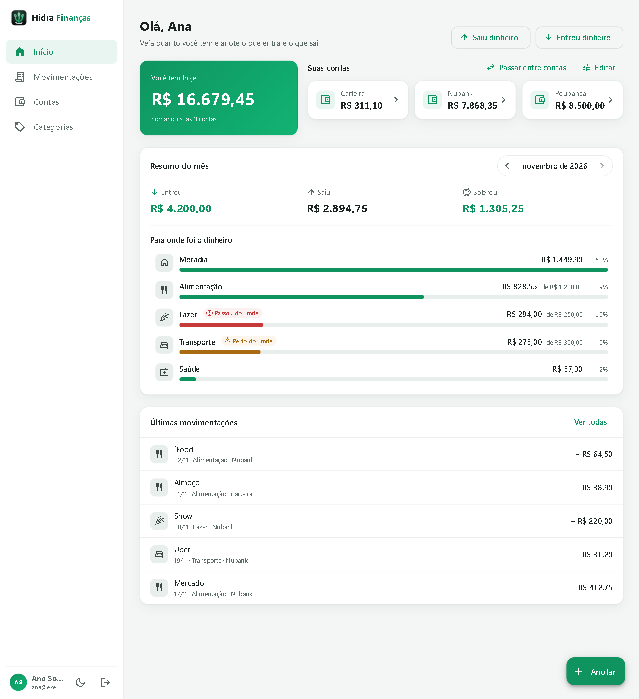
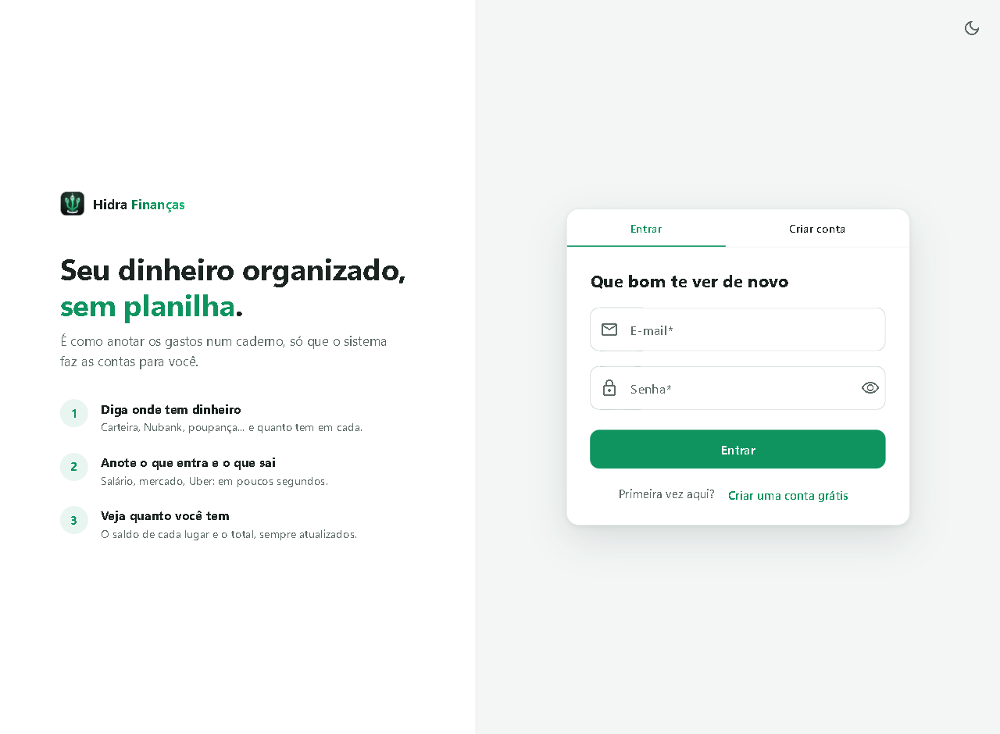
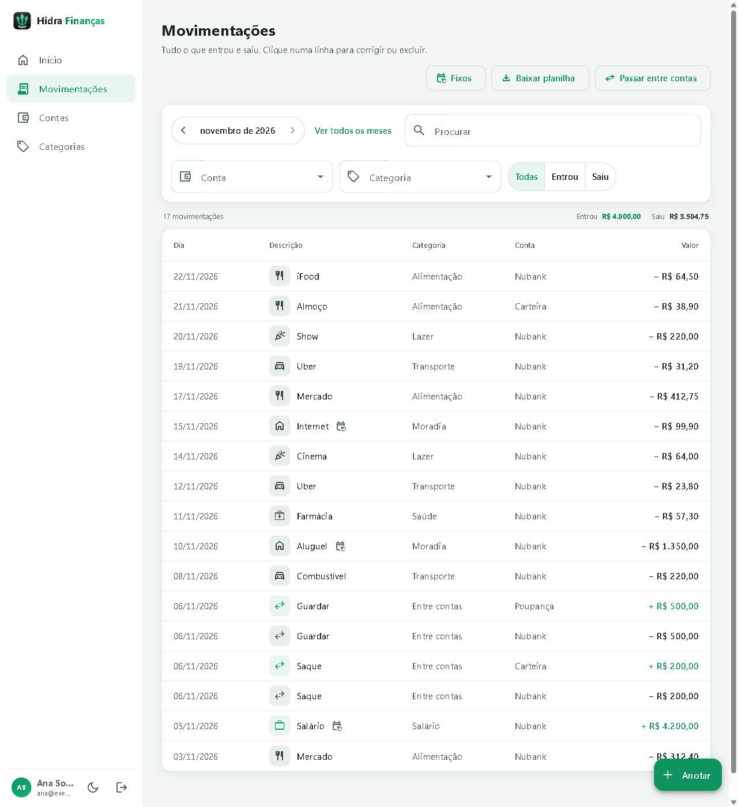
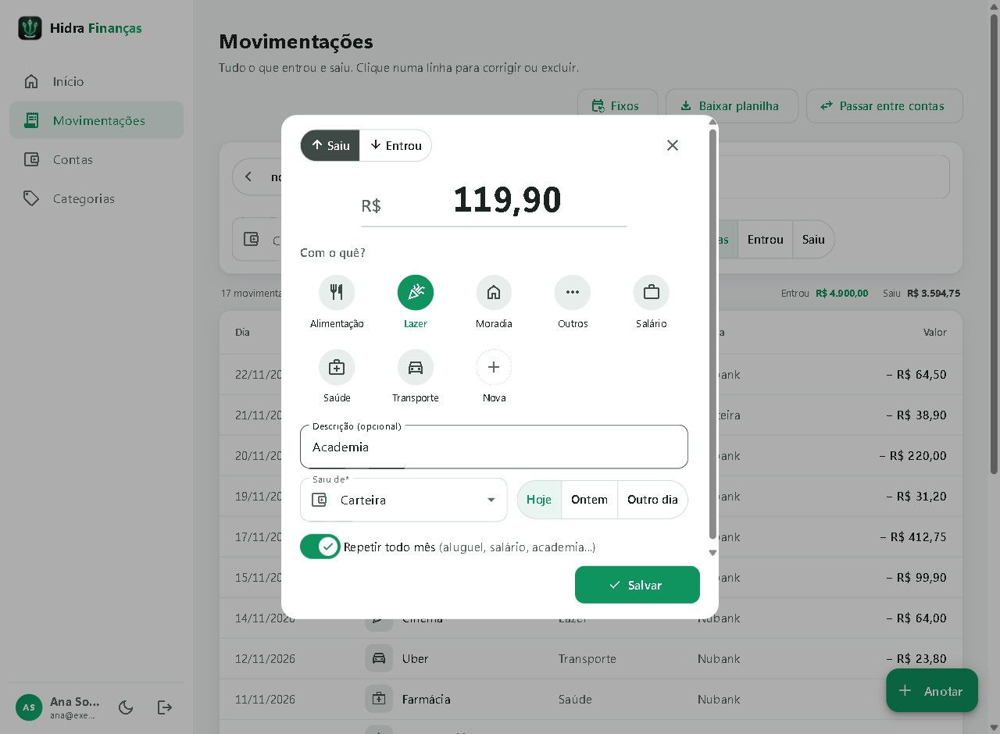
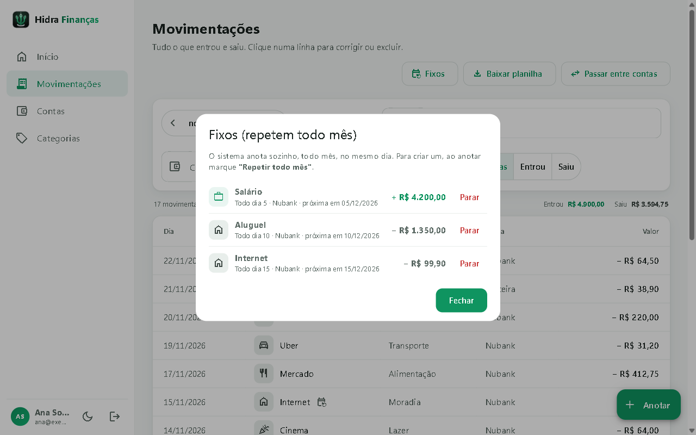
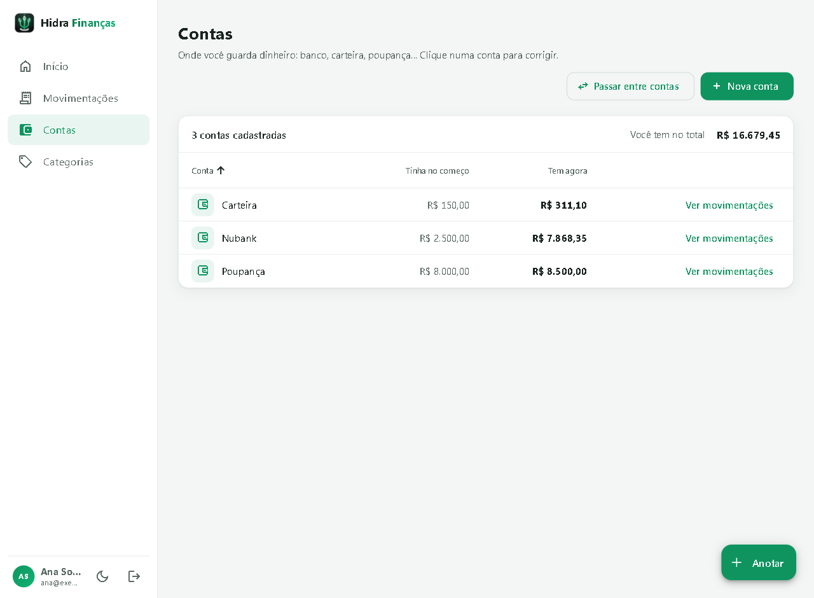
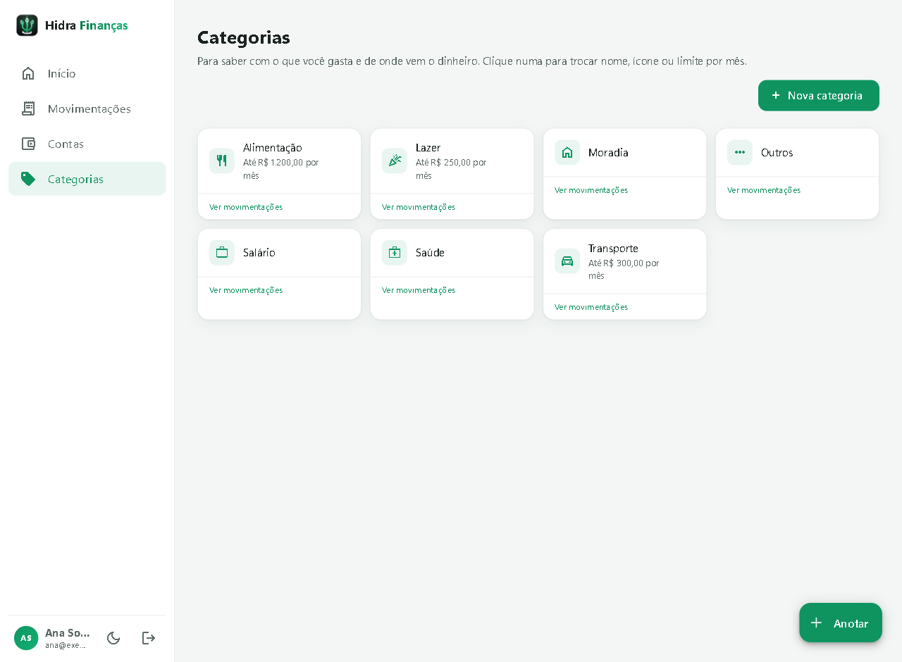
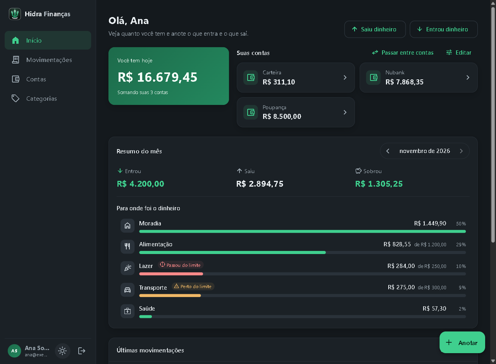

# Hidra Finanças

Software de **gestão financeira pessoal** feito com **Quarkus** e **Angular**: uma "planilha de gastos" em forma de
sistema. Você cadastra suas contas (Nubank, Carteira, Poupança...), lança receitas e despesas com categoria,
transfere entre as contas e vê o saldo de cada uma e o geral.

Projeto da disciplina de **Programação Orientada a Objetos** — EC04 / 2026 — SETREM.
Baseado nos projetos de aula [finance-api](https://github.com/tiagoseibel/finance-api) e
[finance-ui](https://github.com/tiagoseibel/finance-ui).



## Documentação

| Documento | Para quê |
|---|---|
| **[Guia de avaliação](docs/guia-de-avaliacao.md)** | Cada requisito pedido → onde ver na tela, onde está no código e qual teste prova. Roteiro de 10 minutos |
| [Arquitetura](docs/arquitetura.md) | Camadas, diagramas (requisição autenticada, modelo de dados, fixos) e as decisões com o porquê |
| [Especificações das telas](docs/specs/) | O que cada tela faz, no formato "Quando… então…" |
| [Roteiro da apresentação](docs/apresentacao.md) | Ordem da demonstração e respostas para as perguntas prováveis |
| Este README | Como executar, API completa, modelo de dados, POO e segurança |

O código também é documentado: toda classe Java tem Javadoc explicando a responsabilidade dela, e todo
componente/serviço do site tem um comentário dizendo o que faz.

## O que foi pedido × onde está

| Pedido | Onde está |
|---|---|
| Quarkus e Angular | `api/` (Quarkus + Panache + PostgreSQL) e `web/` (Angular 22 + Angular Material) |
| Lançamento de contas | Tela **Contas**: cadastrar, editar e excluir, com saldo inicial — `/contas` |
| Categorias | Tela **Categorias** (cada usuário tem as suas; 7 prontas no cadastro) — `/categorias` |
| Transações | Receitas (E) e despesas (S): botão **+ Anotar** em todas as telas; editar e excluir — `/transacoes` |
| Transações filtradas por categoria e conta | Tela **Movimentações** com filtros — `GET /transacoes?contaId=&categoriaId=` |
| Transferência entre contas | Botão **Passar entre contas** (no Início, em Contas e em Movimentações) — `POST /transacoes/transferencia` (uma saída + uma entrada) |
| Tela inicial com saldo por conta e geral | Tela **Início** — `GET /resumo` (mais o resumo do mês com o gráfico "Para onde foi o dinheiro") |
| Autenticação JWT em cookie httpOnly | `AuthController` + `CookieSessao`: o token vai no cookie `financas_sessao` (HttpOnly, SameSite=Strict) |

### Além do pedido

| O quê | Onde está |
|---|---|
| Movimentações por mês e busca por texto | Tela **Movimentações**: ‹ mês › ou "Ver todos os meses", e o campo **Procurar** — `GET /transacoes?mes=2026-11&busca=uber` |
| Gastos e entradas fixos (aluguel, salário...) | Ao anotar, **Repetir todo mês**: o sistema lança sozinho no mesmo dia (dia 31 vira o último dia em meses curtos). Botão **Fixos** em Movimentações para ver e parar — `/fixas` |
| Limite mensal por categoria | Na categoria, **Limite por mês** (opcional); o Início mostra quanto já foi gasto do limite e avisa quando passa |
| Baixar planilha para o Excel | Botão **Baixar planilha** em Movimentações (respeita os filtros) — `GET /transacoes/planilha` (CSV com `;`, vírgula nos centavos e datas dd/mm/aaaa) |
| Datas digitadas no formato brasileiro | `common/data-br.adapter.ts`: "05/09/2026" é 5 de setembro |

## Telas

| | |
|---|---|
|  **Entrar / Criar conta** |  **Movimentações** com filtros por mês, texto, conta, categoria e tipo |
|  **+ Anotar** (com "Repetir todo mês") |  **Fixos**: o que se repete todo mês |
|  **Contas** com saldo inicial e atual |  **Categorias** com ícone e limite |
|  **Tema escuro** | |

### Palavras do site × termos do pedido

O site usa palavras do dia a dia; no código e na API ficam os termos do pedido:

| No site | No pedido / no código |
|---|---|
| Movimentações | Transações (`Transacao`, `/transacoes`) |
| Entrou / Saiu | Receita / Despesa (tipo `E` / `S`) |
| Passar entre contas | Transferência (`/transacoes/transferencia`) |
| Você tem | Saldo geral |
| Tem agora / Tinha no começo | Saldo atual / Saldo inicial |

## Como executar

Requisitos: **Docker** (para o PostgreSQL), **JDK 21** e **Node.js 22+**.

```bash
# 1. Banco de dados (PostgreSQL 17 em localhost:5434)
docker compose up -d

# 2. API (Quarkus) em http://localhost:8090 — cria as tabelas sozinha
cd api
./mvnw quarkus:dev          # no Windows: mvnw.cmd quarkus:dev

# 3. Site (Angular) em http://localhost:4200 — em outro terminal
cd web
npm install
npm start
```

Abra **http://localhost:4200**, vá na aba **Criar conta** e pronto: você já entra logado, com as categorias padrão,
e um passo a passo pergunta onde você guarda dinheiro (Carteira, Nubank...) e quanto tem em cada lugar.

O site tem **tema claro** (padrão) e **tema escuro**: o botão de lua/sol troca, e a escolha fica salva no navegador.

As portas (8090, 4200 e 5434) são diferentes das do banco-hidra (8080, 4300 e 5433): os dois projetos rodam ao mesmo tempo.

### Acessar de outro computador (professor ou colegas)

Com o sistema rodando no notebook (passos acima), um **túnel da Cloudflare** dá um endereço `https://` público
para o site, sem conta, sem abrir porta no roteador e de qualquer rede. Precisa do
[cloudflared](https://developers.cloudflare.com/cloudflare-one/connections/connect-networks/downloads/)
(Windows: `winget install --id Cloudflare.cloudflared`). Em outro terminal:

```bash
cloudflared tunnel --url http://localhost:4200
```

Ele mostra um link `https://<palavras-aleatorias>.trycloudflare.com`: é só mandar para quem vai usar. Cada pessoa
cria a sua conta e só vê os próprios dados. O link muda toda vez que o túnel é aberto e para de funcionar quando
o terminal é fechado (Ctrl+C).

Por que funciona sem mexer na segurança:

- Só o **site** fica exposto; a API continua escutando só no próprio PC (`127.0.0.1`). O site repassa `/api` para
  ela (`web/proxy.conf.json`), trocando o endereço para `127.0.0.1` (`changeOrigin`), porque o Quarkus recusa
  qualquer outro endereço (proteção contra *DNS rebinding*).
- O `ng serve` só aceita o próprio PC e endereços `*.trycloudflare.com` (`allowedHosts` no `angular.json`).
- Pelo túnel o acesso é HTTPS, e o cookie da sessão ganha a marca **Secure** (`CookieSessao`, teste
  `cookieViaHttpsEhSecure`).

### Testes da API

Sobem um PostgreSQL descartável sozinhos (pelo Docker):

```bash
cd api
./mvnw test                 # 23 testes: saldo, filtros, transferência, fixos, limite, planilha, login, cookie, CSRF, isolamento entre usuários
```

### Compilar para produção

```bash
cd api && ./mvnw package    # gera api/target/quarkus-app/quarkus-run.jar
cd web && npm run build     # gera web/dist/web
```

Em produção o token precisa de chaves RSA próprias (em dev o Quarkus gera sozinho). Elas **não** vão para o Git:

```bash
mkdir -p api/chaves
openssl genrsa -out api/chaves/privada.pem 2048
openssl rsa -in api/chaves/privada.pem -pubout -out api/chaves/publica.pem
```

## Estrutura

```
hidra-financas/
├── api/                        Quarkus (porta 8090)
│   └── src/main/java/
│       ├── entity/             Usuario, Conta, Categoria, Transacao, TransacaoFixa (Panache)
│       ├── service/            regras de negócio (TransacaoService, ContaService, ...)
│       ├── controller/         rotas REST
│       ├── dto/                o que entra e sai da API (records)
│       ├── security/           cookie da sessão, proteção CSRF, usuário logado
│       └── exception/          erros de regra → HTTP 422 / 404 / 401
├── web/                        Angular 22 + Material (porta 4200)
│   └── src/app/
│       ├── common/             login (auth), layout com menu lateral, componentes reutilizáveis
│       └── pages/<funcionalidade>/{model, services, routes, componentes}
├── docs/
│   ├── guia-de-avaliacao.md    requisito → tela → código → teste
│   ├── arquitetura.md          camadas, diagramas e decisões
│   ├── apresentacao.md         roteiro da apresentação
│   ├── specs/                  especificação de cada tela
│   └── imagens/                capturas de tela usadas na documentação
└── docker-compose.yml          PostgreSQL
```

O site segue as instruções da disciplina (`web/.github/instructions/projeto-angular.instructions.md`): só CSS,
**signals**, **reactive forms**, HTML e CSS fora do TypeScript, componentes do **Angular Material** e a estrutura
`pages/<funcionalidade>/{model,services,routes,componentes}`.

## Modelo de dados

| Entidade | Campos |
|---|---|
| `Usuario` | nome, email (único), senhaHash (BCrypt) |
| `Conta` | descricao, saldoInicial, usuario |
| `Categoria` | descricao, icone, limiteMensal (opcional), usuario |
| `Transacao` | descricao, valor, tipo (`E` entrada / `S` saída), datatransacao, conta, categoria, transferencia, fixa |
| `TransacaoFixa` | descricao, valor, tipo, dia (1 a 31), conta, categoria, proxima (próxima data a lançar) |

- **Saldo** de uma conta = saldo inicial + entradas − saídas (método `Conta.saldo()`). O sistema não guarda o saldo:
  ele é calculado a partir das transações, como numa planilha.
- **Transferência** = duas transações com o mesmo código (`transferencia`): uma `S` na conta de origem e uma `E` na
  de destino, gravadas juntas (`@Transactional`: ou grava as duas, ou nenhuma). Excluir uma exclui as duas.
  Transferência não tem categoria e não conta como receita ou despesa no resumo do mês.
- **Fixo** (`TransacaoFixa`) = um molde que se repete todo mês. Não há tarefa agendada: sempre que o Início ou as
  Movimentações são abertos, o sistema lança o que já venceu (`gerarAte()`, que pode lançar vários meses de uma vez)
  e avança a `proxima`. As linhas ficam travadas durante isso, para duas telas abertas juntas não lançarem em dobro.
  Parar de repetir apaga o fixo, mas as transações já lançadas continuam.

## Conceitos de POO no código

- **Encapsulamento**: em `Usuario` a senha é `private` e só entra por `definirSenha()` (grava o hash BCrypt) e só é
  conferida por `senhaConfere()`. Ninguém lê nem grava a senha direto.
- **Herança**: todas as entidades herdam de `PanacheEntity` (ganham `id`, `persist()`, `delete()`, `find()`...).
  As exceções de regra herdam de `RuntimeException`.
- **Responsabilidade de cada objeto**: a `Conta` sabe calcular o próprio saldo (`saldo()`) e dizer se tem transações
  (`temTransacoes()`); a `Transacao` sabe se é transferência (`ehTransferencia()`); a `Categoria` sabe se está em
  uso (`emUso()`); a `TransacaoFixa` sabe lançar os meses que venceram (`gerarAte()`) e qual é o dia certo num mês
  mais curto (`noDia()`).
- **Objetos de valor imutáveis**: o que entra e sai da API são `record`s (`dto/Dtos.java`), sem setters.
- **Camadas**: controller (HTTP) → service (regras) → entity (dados). O controller nunca tem regra de negócio.

## Segurança

- **JWT em cookie httpOnly**: no login/cadastro a API gera um JWT assinado (RSA, 1 hora) e devolve no cookie
  `financas_sessao` com `HttpOnly` (o JavaScript não lê: um script injetado não rouba a sessão) e `SameSite=Strict`
  (outro site não consegue usá-lo). O token nunca aparece no corpo da resposta nem no `localStorage`.
  O Quarkus lê o token do cookie (`mp.jwt.token.cookie` no `application.properties`).
- **CSRF**: toda requisição que muda dados exige o cabeçalho `X-Requested-With` (`ProtecaoCsrf`), que o site manda
  em todas as chamadas (`auth.interceptor.ts`).
- **Cada um só vê o que é seu**: o dono vem sempre do token (`UsuarioLogado`), nunca do corpo da requisição.
  Conta, categoria ou transação de outra pessoa responde **404**.
- **Senha**: 8 a 72 caracteres, com letras e números; guardada só como hash BCrypt. E-mail inexistente e senha
  errada dão a mesma mensagem (não revela quem tem cadastro).

## API

Todas as rotas (menos cadastro e login) exigem o cookie de sessão. Erros voltam como `{"erro": "mensagem"}`:
**422** regra de negócio, **404** não encontrado, **401** sem login, **403** sem o cabeçalho `X-Requested-With`.

| Método | Rota | O que faz |
|---|---|---|
| POST | `/auth/cadastro` | `nome`, `email`, `senha` → cria o usuário e já abre a sessão |
| POST | `/auth/login` | `email`, `senha` → grava o cookie de sessão |
| POST | `/auth/sair` | Apaga o cookie |
| GET | `/auth/eu` | Quem está logado |
| GET / POST | `/contas` | Lista (com saldo) / cria (`descricao`, `saldoInicial`) |
| GET / PUT / DELETE | `/contas/{id}` | Busca / atualiza / exclui (só sem transações) |
| GET / POST | `/categorias` | Lista / cria (`descricao`, `icone`, `limiteMensal`) |
| GET / PUT / DELETE | `/categorias/{id}` | Busca / atualiza / exclui (só se não estiver em uso) |
| GET | `/transacoes?contaId=&categoriaId=&tipo=&mes=&busca=` | Lista com filtros opcionais |
| GET | `/transacoes/planilha?...` | Os mesmos filtros, como CSV para o Excel |
| POST | `/transacoes` | Lança: `descricao`, `valor`, `tipo` (E/S), `datatransacao`, `contaId`, `categoriaId`, `repetir` (opcional) |
| GET / PUT / DELETE | `/transacoes/{id}` | Busca / atualiza / exclui |
| POST | `/transacoes/transferencia` | `origemId`, `destinoId`, `valor`, `datatransacao`, `descricao` |
| GET | `/fixas` | Gastos e entradas fixos (repetem todo mês) |
| DELETE | `/fixas/{id}` | Para de repetir (o que já foi lançado continua) |
| GET | `/resumo?mes=2026-11` | Saldo de cada conta e geral (hoje); receitas, despesas e gastos por categoria do mês; últimas transações |
