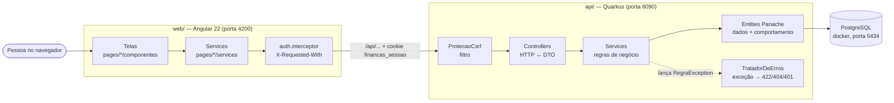
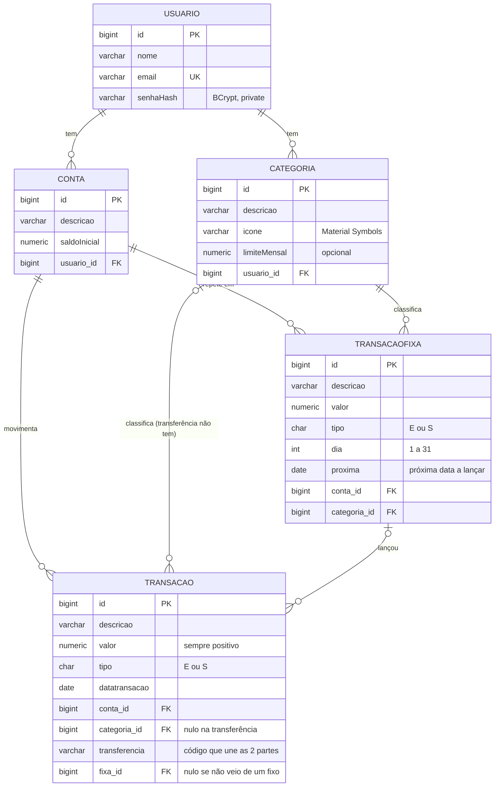
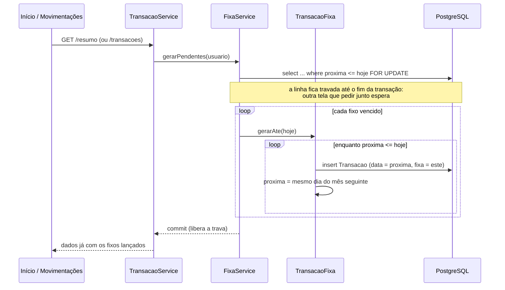

# Arquitetura

Como o Hidra Finanças é montado por dentro: as partes, o caminho de uma requisição, o modelo de dados e as
decisões tomadas (com o porquê de cada uma).

> Os diagramas estão em [Mermaid](https://mermaid.js.org/): o GitHub desenha eles sozinho ao abrir este arquivo.

## 1. Visão geral



- O site chama a API pelo próprio endereço (`/api/...`) e o `ng serve` repassa para `localhost:8090`
  (`web/proxy.conf.json`). Por isso o cookie é do mesmo site e não precisa de CORS.
- A API só escuta em `127.0.0.1` em desenvolvimento (`application.properties`).
- **No ar** (<https://hidra-financas.onrender.com>) é um container só: o Quarkus entrega o site e a API em `/api`,
  e o banco fica no Neon. Detalhes e diagrama em [hospedagem-render.md](hospedagem-render.md).

## 2. Camadas da API

| Camada | Pasta | Responsabilidade | Não faz |
|---|---|---|---|
| Controller | `controller/` | Recebe HTTP, chama o service, devolve DTO e status (201, 204...) | Regra de negócio |
| DTO | `dto/Dtos.java` | O que entra (`*Form`) e o que sai (`*Dto`) da API, como `record` | Acessar banco |
| Service | `service/` | Regras: validar, conferir dono, montar consultas, `@Transactional` | Saber de HTTP |
| Entity | `entity/` | Tabelas (Panache) e o comportamento de cada objeto (`Conta.saldo()`, `TransacaoFixa.gerarAte()`) | Saber de HTTP |
| Security | `security/` | Cookie da sessão, proteção CSRF, quem é o usuário logado | — |
| Exception | `exception/` | Exceções de regra e a tradução para HTTP (`TratadorDeErros`) | — |
| Config | `config/` | Só na nuvem: banco pela `DATABASE_URL` e telas do site abertas direto ([hospedagem](hospedagem-render.md)) | Regra de negócio |

Exemplo do caminho de "excluir uma categoria":

```
DELETE /categorias/7
  → CategoriaController.excluir(7)              só repassa
  → CategoriaService.excluir(7, usuarioLogado)  busca (de outro usuário = 404), confere se está em uso
  → Categoria.emUso()                            a própria categoria sabe se está em uso
  → RegraException("...em uso...")               → TratadorDeErros → HTTP 422 {"erro": "..."}
```

## 3. Uma requisição autenticada, passo a passo

```mermaid
sequenceDiagram
    autonumber
    participant N as Navegador (Angular)
    participant Q as Quarkus
    participant J as SmallRye JWT
    participant S as Service
    participant B as PostgreSQL

    N->>Q: POST /api/auth/login {email, senha}
    Q->>S: AuthService.entrar → Usuario.senhaConfere (BCrypt)
    S-->>Q: Usuario
    Q-->>N: 200 + Set-Cookie: financas_sessao=JWT; HttpOnly; SameSite=Strict
    Note over N: O JavaScript não consegue ler esse cookie

    N->>Q: POST /api/transacoes + cookie + X-Requested-With
    Q->>Q: ProtecaoCsrf: tem X-Requested-With? (senão 403)
    Q->>J: valida assinatura e validade do JWT do cookie (senão 401)
    J-->>Q: subject = id do usuário
    Q->>S: TransacaoService.lancar(form, UsuarioLogado.usuario())
    S->>B: confere se a conta e a categoria são desse usuário, insert
    B-->>S: ok
    S-->>N: 201 {transação}
```

O dono dos dados **sempre** sai do token (`UsuarioLogado`), nunca do corpo. Toda consulta filtra por
`usuario` (ou `conta.usuario`), então pedir o id de algo de outra pessoa responde 404, como se não existisse.

## 4. Modelo de dados



As tabelas são criadas e atualizadas pelo Hibernate a partir das entidades
(`quarkus.hibernate-orm.schema-management.strategy=update`). Nos testes o banco é recriado do zero.

### Regras que o modelo garante

| Regra | Onde |
|---|---|
| Saldo = saldo inicial + entradas − saídas (não é coluna: é calculado) | `Conta.saldo()` + `Transacao.somar()` |
| Valor sempre positivo; o sinal vem do tipo `E`/`S` | `Validar.valorPositivo()` |
| Transferência = 2 transações (S na origem, E no destino) com o mesmo código, gravadas juntas | `TransacaoService.transferir()` + `@Transactional` |
| Excluir uma parte da transferência exclui as duas | `TransacaoService.excluir()` |
| Conta/categoria em uso (em transações ou fixos) não pode ser excluída | `Conta.temTransacoes()`, `Categoria.emUso()` |
| Fixo no dia 31 cai no último dia dos meses curtos | `TransacaoFixa.noDia()` |
| Fixo não é lançado em dobro quando duas telas abrem juntas | `FixaService.gerarPendentes()` com `PESSIMISTIC_WRITE` |

## 5. Gastos fixos (como funciona o "repetir todo mês")



Não existe tarefa agendada: o sistema lança "sob demanda", na hora em que alguém vai ver os dados. O resultado
para a pessoa é o mesmo e não precisa de um processo rodando sozinho no servidor.

## 6. Site (Angular)

```
web/src/app/
├── app.config.ts          providers globais (rotas, HttpClient + interceptor, pt-BR, datas dd/mm/aaaa)
├── app.routes.ts          mapa das telas (lazy loading)
├── common/                o que mais de uma tela usa
│   ├── auth/              AuthService (signal com o usuário), guards, interceptor (X-Requested-With)
│   ├── layout/            moldura com menu lateral + botão fixo "+ Anotar"
│   ├── confirmacao/       diálogo "Tem certeza?"
│   ├── tema/              tema claro/escuro
│   ├── dinheiro.ts        lê "1.500,00" / "25,90" / "7.5"
│   ├── data-br.adapter.ts lê datas digitadas como dia/mês/ano
│   └── erros.ts           transforma o erro da API em frase para a pessoa
└── pages/<funcionalidade>/
    ├── model/             interfaces (o formato dos dados da API)
    ├── services/          chamadas HTTP daquela funcionalidade
    ├── routes/            rota da funcionalidade
    └── componentes/       telas e diálogos (cada um com .ts, .html e .css separados)
```

Padrões seguidos (instruções da disciplina em `web/.github/instructions/projeto-angular.instructions.md`):

- **Signals** para o estado da tela (`signal`, `computed`, `input`) e **reactive forms** para os formulários.
- HTML e CSS em arquivos próprios (nada de template dentro do `.ts`), só CSS (sem Tailwind/SCSS).
- Componentes do **Angular Material** (diálogos, tabela, selects, datepicker, snackbar...).
- Os filtros de Movimentações ficam na **URL** (`withComponentInputBinding`): F5 e "voltar" mantêm o filtro, e o
  Início abre a lista já filtrada só montando o link.
- Quando algo é anotado ou excluído em qualquer tela, o `AnotarService` avisa e as telas abertas recarregam.

## 7. Decisões (e o porquê)

| Decisão | Alternativa | Por quê |
|---|---|---|
| JWT em **cookie httpOnly** | Token no `localStorage` | Um script injetado (XSS) lê o `localStorage`, mas não lê cookie httpOnly |
| `SameSite=Strict` + cabeçalho `X-Requested-With` | Token CSRF em formulário | Duas barreiras simples: outro site não manda o cookie nem consegue pôr o cabeçalho |
| Saldo **calculado** | Coluna `saldo` atualizada a cada lançamento | Nunca fica desatualizado ao editar/excluir; é como a soma de uma planilha |
| Transferência = **2 transações** | Tabela própria de transferências | Igual ao `finance-api` da aula; cada conta vê a sua parte no extrato |
| Fixos lançados **sob demanda** | Tarefa agendada (`@Scheduled`) | Menos peças; funciona mesmo se o servidor ficou desligado (lança os meses que faltaram) |
| **Trava pessimista** ao lançar fixos | Nenhuma / `@Version` | Sem trava, duas telas abertas juntas lançavam em dobro; com `@Version` a segunda daria erro 500 |
| Filtros na **URL** | Estado só na memória | F5 mantém, dá para compartilhar o link e o Início abre a lista filtrada |
| CSV com `;`, vírgula e BOM | CSV "americano" (`,` e ponto) | É o formato que o Excel em português abre direto, com acentos certos |
| Palavras do dia a dia no site | Termos técnicos (receita/despesa) | Quem usa não precisa saber contabilidade; no código ficam os termos do pedido |
